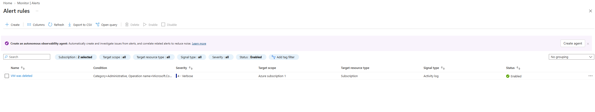
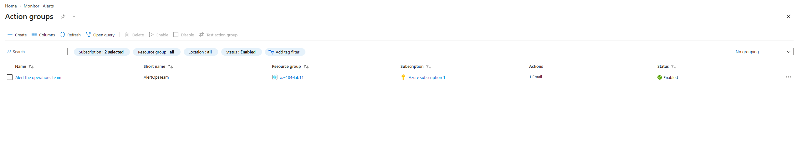
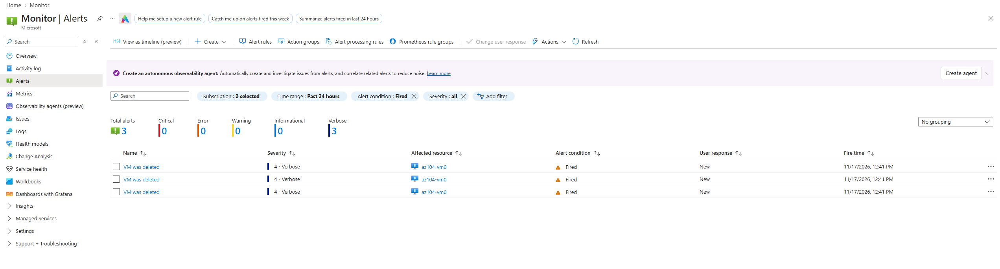
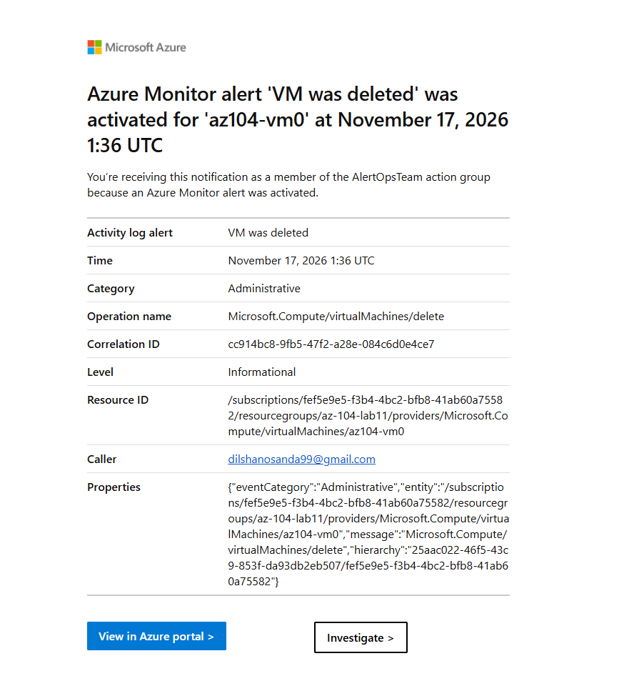
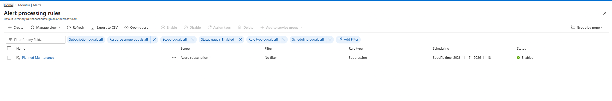

# Lab 11 — Implement Azure Monitoring

**Source:** [MicrosoftLearning AZ-104 Labs](https://github.com/MicrosoftLearning/AZ-104-MicrosoftAzureAdministrator)

## Objective

Deploy and configure Azure monitoring for a Windows virtual machine.

## Implementation

- Deployed Azure infrastructure using an ARM template.
- Configured Azure Monitor Agent and Data Collection Rules.
- Queried VM heartbeat and performance data using KQL.
- Created an Activity Log alert for VM deletion.
- Configured an action group for email notifications.
- Created an alert processing rule for planned maintenance.

## Validation

- Confirmed monitoring data in Log Analytics.
- Deleted the test VM to trigger an alert.
- Verified the alert appeared in Azure Monitor.
- Received the VM deletion email notification.
- Verified the alert processing rule was enabled.

## Technologies

Azure Monitor · Log Analytics · KQL · ARM Templates · Azure Virtual Machines · Azure Alerts

## Screenshots

### Activity Log Alert

### Action Group

### Fired Alerts

### Email Notification

### Alert Processing Rule

